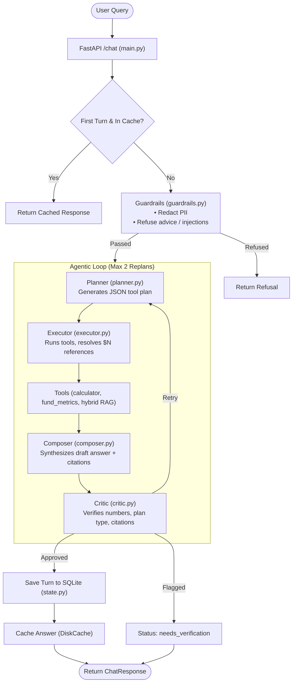

# Mutual Fund Factsheet & SID Q&A Copilot — Codebase Explanation

## 1. System Overview & Architecture Philosophy

This project implements an **Agentic Retrieval-Augmented Generation (RAG)** copilot designed to answer user inquiries about Indian mutual fund factsheets and Scheme Information Documents (SIDs).

The architecture is specifically engineered to run reliably on smaller hosted or local models ($\le$ 8B parameters, such as LLaMA-3.1-8B-Instruct). Smaller models commonly suffer from arithmetic hallucination, weak instruction following for complex constraints, and susceptibility to prompt injections. This system compensates through strict agentic design:

- **No Arithmetic in LLM:** Math (SIP future values, CAGR, expense ratio cost drag, percentage changes) is entirely delegated to a deterministic Python calculator tool.
- **Structured Metric Lookup:** Quantitative facts (AUM, Total Expense Ratio, exit loads, benchmark names) are queried directly from a verified tabular data store rather than relying solely on fuzzy semantic retrieval.
- **Deterministic Critic:** A rule-based reviewer checks that every number in the proposed answer is explicitly grounded in evidence or the user's prompt, that plan options (Direct vs. Regular) match the query, and that citations are provided.
- **Multi-layered Guardrails:** Prevents SEBI-regulated investment advice, blocks prompt injections, and redacts PII before queries enter the agent loop.

---

## 2. Architecture & Request Lifecycle



---

## 3. Deep Dive: `app/main.py`

`mf_copilot/app/main.py` serves as the primary HTTP API layer built on **FastAPI**.

### A. Initialization & Setup
- **Rate Limiting (`slowapi`):** Employs `Limiter(key_func=get_remote_address)` with a configurable threshold (default: `20/minute`) to prevent abuse and denial-of-service.
- **Disk Caching (`diskcache`):** Uses file-backed caching (`data/cache/`) to store responses and survive process restarts.

### B. Application Lifespan (`lifespan`)
```python
@asynccontextmanager
async def lifespan(app: FastAPI):
    init_tracing()
    if not (settings.index_dir / "chunks.json").exists():
        try:
            print("Index missing; built", build_index(), "chunks")
        except Exception as e:
            print("Index build failed:", e)
    yield
```
- Initializes OpenTelemetry tracing (`init_tracing()`).
- Automatically verifies if the document vector index (`data/index/chunks.json`) exists. If missing, it builds the index automatically on startup.

### C. Health Check (`GET /health`)
- Returns JSON status including the active `llm_mode` (`"mock"` or `"api"`) and `max_steps` cap.

### D. Chat Endpoint (`POST /chat`)
Handles user interactions, conversation state, caching, and agent invocation:
1. **Turn Detection:** Checks `state.history(body.session_id, 1)`. If empty, the query is marked as `first_turn`. Subsequent follow-ups in a conversation are not cached because context depends on session memory.
2. **Deterministic Cache Key:** Computes a SHA-256 hash using the active planner strategy and normalized question text:
   $$\text{Key} = \text{SHA256}(\text{strategy} \parallel \text{question.strip().lower()})$$
3. **Cache Hit Path:** On a cache hit for a first-turn question, appends the user query and cached answer to the SQLite session database and immediately returns with `cached=True` and `latency_ms=0`.
4. **Agent Execution:** For cache misses or follow-up turns, calls `run_agent(body.question, body.session_id)` in `app.agent.graph`.
5. **State & Cache Update:** Records the user turn and assistant response in the session database. If `first_turn` and the response status is `"answered"` or `"refused"`, saves the result to `diskcache` with a TTL (default: 3600 seconds).

### E. Session History (`GET /sessions/{session_id}/history`)
- Queries the SQLite persistent store and returns the last 50 conversational turns for the specified session.

---

## 4. Component-by-Component Analysis

### 4.1 Orchestration (`app/agent/graph.py`)
`run_agent()` drives the complete reasoning loop:
1. Starts an OpenTelemetry span (`agent.request`).
2. **Redacts PII** using `redact_pii()`.
3. **Checks Scope** using `check_scope()`. If the user asks for investment advice or attempts a prompt injection, immediately returns `REFUSAL_TEXT`.
4. Retrieves prior conversational turns from `app/agent/state.py`.
5. Enters a bounded replan loop (up to `max_replans + 1` iterations):
   - **Planner:** Generates a tool invocation plan.
   - **Executor:** Executes the planned tools and returns observations.
   - **Composer:** Produces a draft answer and collects citations.
   - **Critic:** Evaluates the answer. If approved, returns `answered`. If retrying is allowed, feeds the critic's feedback back into the planner.
6. If retries run out without approval, returns status `needs_verification` with notes for human analysts.
7. Catches `BudgetExceeded` and `LLMError` to fail gracefully without crashing.

---

### 4.2 Guardrails & Safety (`app/guardrails.py`)
- **Advice Filter:** Regex patterns detect queries seeking advice (e.g., `should I buy`, `which fund is best`, `recommend`, `predict returns`). In compliance with SEBI regulations, the system refuses to answer and prompts the user to consult a SEBI-registered advisor.
- **Injection Filter:** Rejects instructions attempting to override system behavior (e.g., `ignore previous instructions`, `you are now`, `system prompt`).
- **PII Masking:** Detects and masks Indian PAN cards (`[PAN]`), Aadhaar numbers (`[AADHAAR]`), folio numbers (`[FOLIO]`), phone numbers (`[PHONE]`), and email addresses (`[EMAIL]`).
- **Indirect Injection Sanitization (`sanitize_context`):** Strips lines from retrieved document chunks containing adversarial or prompt-injection text before sending them to the LLM.

---

### 4.3 Planning Engine (`app/agent/planner.py` & `mock.py`)
- **Prompting Strategies:**
  1. `structured`: Standard few-shot prompt with strict JSON schema instructions.
  2. `cot`: Requires step-by-step reasoning within a `"reasoning"` JSON field prior to generating steps.
  3. `decomposition`: Instructs the model to split multi-faceted questions into atomic sub-questions.
- **Tool Specification:** Defines exact signatures and guidelines for the 3 tools:
  - `search_scheme_docs`
  - `get_fund_metric`
  - `calculator`
- **Mock Mode (`mock.py`):** Provides a deterministic regex/rule-based planner for testing without LLM endpoints or external dependencies.

---

### 4.4 Tool Execution Engine (`app/agent/executor.py`)
- **Pydantic Validation:** Every tool call argument is validated through Pydantic schemas (`SearchArgs`, `MetricArgs`, `CalcArgs`).
- **Dynamic Variable Resolution (`_resolve`):** Supports chaining steps using references such as `"$1.numeric"`. For example:
  - Step 1: `get_fund_metric` gets the expense ratio (e.g. `1.25`).
  - Step 2: `calculator` uses `"expense_pct": "$1.numeric"` to calculate fee drag over 10 years.
- **Loop Detector:** Tracks `(tool, args)` tuples. If an identical tool call is repeated, execution halts with a loop error to prevent infinite runs.
- **Budget Tracking:** Each tool invocation registers against the per-query `Budget` instance.

---

### 4.5 The Three Specialized Tools (`app/tools/`)
1. **Calculator (`calculator.py`):**
   - Pure Python arithmetic.
   - Operations:
     - `sip_fv`: Future value of a Systematic Investment Plan assuming beginning-of-month payments:
       $$FV = P \times \frac{(1 + r)^n - 1}{r} \times (1 + r)$$
     - `expense_cost`: Compares gross vs. net future values to illustrate total expense ratio drag:
       $$\text{Cost} = A \times (1 + r_{\text{gross}})^t - A \times (1 + (r_{\text{gross}} - r_{\text{expense}}))^t$$
     - `cagr`: Compound annual growth rate:
       $$\text{CAGR} = \left(\frac{\text{End}}{\text{Start}}\right)^{\frac{1}{t}} - 1$$
     - `pct_change` & `diff`.
2. **Fund Metrics (`fund_metrics.py`):**
   - High-precision lookup in `data/fund_metrics.csv`.
   - Filters on `scheme`, `metric`, `plan` (Direct vs. Regular), and `option` (Growth vs. IDCW).
   - Resolves aliases (e.g., `ter` $\rightarrow$ `expense_ratio`).
3. **Document Search (`search_docs.py`):**
   - Invokes the hybrid retriever over factsheets and SIDs.
   - Passes chunks through `sanitize_context` to filter out prompt injections.

---

### 4.6 Hybrid RAG System (`app/rag/`)

#### Ingestion (`ingest.py`)
- Reads `.txt`, `.md`, and `.pdf` documents from `data/docs/`.
- Extracts metadata (`scheme`, `month`, `doc_type`) and sections (splitting on `## Section` headings or PDF pages).
- Chunks text by word count (default: 400 words with 50-word overlap).
- Generates embeddings and saves:
  - `data/index/chunks.json` (chunk metadata and text)
  - `data/index/embeddings.npy` (dense vectors)
  - `data/index/meta.json` (indexing parameters)

#### Hybrid Retrieval (`retriever.py`)
- **BM25 Search:** Lexical matching using `rank_bm25.BM25Okapi`.
- **Dense Vector Search:** Cosine similarity via dot product on normalized embeddings.
- **Reciprocal Rank Fusion (RRF):** Merges ranked candidate lists without needing score calibration:
  $$\text{Score}_{\text{RRF}}(d) = \sum_{m \in \{\text{BM25}, \text{Dense}\}} \frac{1}{60 + \text{Rank}_m(d)}$$
- **Optional Cross-Encoder Reranker:** Re-scores top candidates using models like `BAAI/bge-reranker-base` if configured.

---

### 4.7 Answer Composer (`app/agent/composer.py`)
- Takes the gathered observations and synthesizes the final user-facing response.
- In `mock` mode: Constructs a formatted string directly from observation results.
- In `api` mode: Prompts the LLM with strict constraints (state units, plan/option, cite sources as `[doc_id]`, never use outside knowledge or give advice).
- Collects and deduplicates citations based on document ID and section.

---

### 4.8 Deterministic Critic (`app/agent/critic.py`)
Guarantees reliability before an answer reaches the user:
1. **Plan & Option Verification:** Checks if the question asked for "Regular" but the tool fetched "Direct" (or vice-versa).
2. **Numeric Grounding:** Extracts all numbers from the draft answer (excluding citation brackets) and verifies that every number exists in either:
   - The question text, or
   - The tool observation data.
   Matches within a tight numerical tolerance (relative $10^{-3}$, absolute $0.01$).
3. **Citation Requirement:** Ensures any source-based answer includes at least one valid citation.

---

### 4.9 Cost Budget & Safety Caps (`app/budget.py`)
- Enforces hard ceilings per query:
  - `max_steps` (default: 10)
  - `token_budget` (default: 8000 tokens)
- Raises `BudgetExceeded` if exceeded, triggering an orderly fallback response.

---

### 4.10 Session Memory & Observability
- **Conversation State (`app/agent/state.py`):** Uses SQLite (`data/sessions.db`) to store user and assistant turns per session ID. Enables follow-up questions (e.g., "What about its regular plan?").
- **Tracing (`app/observability.py`):** Uses OpenTelemetry. Every request, planner invocation, tool call, composer call, and critic review is logged as a JSON span in `logs/spans.jsonl` (and optionally streamed to an OTLP endpoint like Langfuse).

---

## 5. User Interface (`ui/streamlit_app.py`)
A lightweight chat interface built using Streamlit:
- Maintains a unique session ID.
- Displays conversation history with expandable citation pills (`📎 doc_id / section`).
- Highlights answers that require human review with a warning badge (`Needs analyst verification`).
- Communicates directly with the FastAPI `/chat` endpoint over HTTP.

---

## 6. How to Run the Project

### Environment Setup
```bash
# Activate virtual environment
.venv\Scripts\activate

# Install requirements
pip install -r requirements.txt
```

### Building the Vector Index
```bash
python -m app.rag.ingest
```

### Running the API & UI
```bash
# Terminal 1: Start FastAPI
uvicorn app.main:app --reload

# Terminal 2: Start Streamlit UI
streamlit run ui/streamlit_app.py
```

### Running Test Suite
```bash
pytest -q
```
